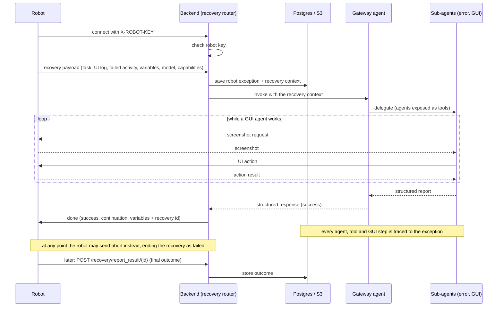

# Architecture

How the R2Framework backend is put together today. This document explains concepts and how they
connect, and points to the code for detail. It does not list endpoints, fields or tables: the code
and the OpenAPI reference (`/scalar`) are the source of truth for those. What is implemented versus
planned is tracked in [`REQUIREMENTS.md`](REQUIREMENTS.md).

## 1. Overview

The backend is a single FastAPI application (`main.py`) that receives failures from RPA robots and
tries to recover them with LLM agents. Its main parts:

| Part | Role | Where |
| --- | --- | --- |
| Recovery ingress | WebSocket a robot opens when it fails; one recovery per connection | `routers/recovery.py` |
| Agents | Database-configured Strands agents: a gateway agent and the sub-agents it delegates to | `database/agents/` |
| Tools | Python functions agents can call, registered in the database | `database/tools/`, `agent_tools/`, `gateway/` |
| Provider routers | Which LLM backend and model each agent uses | `database/provider/`, `routers/provider.py` |
| Trace logging | Per-recovery record of agent, tool and GUI steps, with screenshots in S3 | `database/logging/`, `agent_tools/hooks.py`, `s3/` |
| Auth | Robot keys for robots, JWT sessions for users | `security/`, `middlewares/auth.py`, `routers/keys.py`, `routers/auth.py` |
| Observability | OpenTelemetry traces and logs exported to SigNoz | `observability/`, [`OBSERVABILITY.md`](OBSERVABILITY.md) |
| Evals | Offline benchmarks of the agents, plus an eval WebSocket | `evals/`, `routers/evals.py` |

State lives in Postgres (configuration and traces) and in S3-compatible storage (screenshots). The
supporting services run from `docker/` (see [`docker/README.md`](docker/README.md)).

## 2. Recovery lifecycle

1. **Connect.** A robot opens the recovery WebSocket with its robot key in the `X-ROBOT-KEY`
   header. Unknown or disabled keys are rejected before the socket is accepted. The server sends
   periodic pings while the recovery runs.
2. **Submit.** The robot sends one recovery payload. It is validated against the payload model
   (`templates/recovery_payload.py`) and normalised into a recovery context: the task, platform, the
   ordered UI log, the failed activity, the variables, the process model and the robot's
   capabilities (see [Robot protocol](#robot-protocol)).
3. **Persist.** The raw payload is saved as a robot exception together with its recovery context
   (`database/logging/models.py`). The exception id is the recovery id used everywhere afterwards.
4. **Run the gateway.** The backend loads the agent of type `GatewayAgent` and invokes it with the
   recovery context. The WebSocket and the exception id travel in the Strands invocation state, so
   every nested agent and tool can reach the robot and attach its traces to the right recovery.
5. **Delegate.** Agents call sub-agents as tools. In the seeded configuration the gateway hands UI
   errors to an error agent, which in turn uses a GUI agent to act on the desktop and then names the
   task of the process model the robot should run next. It can only do so through the
   `set_continuation` tool (`agent_tools/utils.py`), which checks the task against the model and the
   loop passes against the loops enclosing it (`agent_tools/process_model.py`). A wrong guess comes
   back to the agent as a correction, so it is fixed inside the agent loop instead of failing the
   recovery.
6. **Drive the desktop.** A GUI agent asks the robot for screenshots and sends it UI actions
   (click, type, scroll...) over the same WebSocket; the robot executes them and replies. This is the
   robot-side contract implemented by the test client in `scripts/recovery_ws_client/`.
7. **Finish.** The robot gets a `done` message with the recovery id. Only `success` comes from the
   gateway's answer; the continuation is the one `set_continuation` stored, and the variables are the
   payload's, as changed by the GUI agents. A reported success without a stored continuation is sent
   as a failure. The success sent is stored on the exception. `done` is sent only for a recovery that
   was persisted and run; every other ending (an invalid payload, a server without a gateway agent,
   an unexpected failure) is an `error` message with a machine-readable code, and the socket is
   closed. The robot can also end the recovery itself with `abort`.
8. **Report.** Once the robot (or its orchestrator) knows whether the process really continued, it
   reports the outcome through the report-result endpoint, authenticated with the same robot key.

### Robot protocol

The robot speaks first and once: the recovery payload. After that it only answers the server's
requests, except for `abort`, which it can send at any time. `robot/channel.py` owns the socket
from accept to close: it sends keep-alive pings, routes `abort` away from the frames the GUI tools
wait for, and closes the socket. The exact fields are in the models named below and in `/scalar`.

**The payload** (`RecoveryPayload`) describes the failed run. Three kinds of id appear in it, and
they mean different things:

- `model` is the **process model**, in BPMN 2.0 XML or another textual format (such as the
  Playwright bridge's compact outline). Its task ids are **model event ids**: stable across runs and
  loop passes.
- Each UI log entry and the failed activity have an `event_id`, which only identifies that
  **occurrence** in this run (a task done three times in a loop has three), and an optional
  `model_event_id` naming the task it performed. When `model_event_id` is missing, agents fall back
  to matching `event_name` against task names.
- `activity_id` groups events semantically and is never a continuation target.

`capabilities` says how the robot can be observed and driven: the modalities it supports (`vision`,
`dom`, `a11y`), most preferred first, whether it can do OCR, and per-modality details. A robot that
sends none supports `vision` only. It is stored with the recovery context. For now GUI agents use
`vision` only, and refuse to act for a robot that leaves it out.

**During the recovery** the server sends `ping`, `screenshot` (the robot answers with one binary JPEG
frame) and `action` (the robot answers with a JSON result: `success`, `action_type` and, on failure,
`error`, which the GUI agent sees as a tool error).

**The recovery ends** in exactly one of these ways:

| Ending | Sent by | Message | Socket close |
| --- | --- | --- | --- |
| The recovery ran | server | `done`: the recovery `id` and `ResponseToRPA` (`templates/gateway.py`) | 1000 |
| The payload is not JSON or not valid | server | `error`, `INVALID_RECOVERY_PAYLOAD` | 1003 |
| No gateway agent is configured | server | `error`, `NO_GATEWAY_AGENT` | 1011 |
| Anything unexpected | server | `error`, `INTERNAL_ERROR` | 1011 |
| The robot gives up | robot | `abort`, with its own `error_code` and `error_description` | 1000, no `done` |

`done.content` tells the robot whether the recovery worked and where to resume: `success`;
`process_finished` when the agents completed the rest of the process themselves;
`continue_from_model_event_id`, the task to run next (naming the failed task means "retry it", an
earlier one means "go back"); `loop_iteration`, one 0-based pass per loop enclosing that task,
outermost first; and `variables`, the payload's variables as the recovery left them. Without
success there is no continuation. An `abort` cancels the agents and stores the robot's reason on
the exception, which counts as a failed recovery; an abort sent before the payload just closes the
socket.

## 3. Agents

**Agents are data, not code.** An agent is a database row (`database/agents/models.py`) holding its
prompt, typed input arguments, response model, input type (text or image + text), provider router,
tools and sub-agents. Invoking an agent builds a Strands agent from that row on the fly, validates the
inputs, runs it, and asks for a structured response using the configured Pydantic model.

- **Types.** `AgentType` distinguishes the gateway (the entry point for every recovery), error
  agents, GUI agents and generic agents. Recovery uses the first `GatewayAgent` it finds, so keep
  exactly one.
- **Composition.** Sub-agents are exposed to their parent as tools, so delegation is just a tool
  call. Each tool or sub-agent link can carry a call limit, enforced by a hook
  (`agent_tools/hooks.py`). Disabled agents are left out.
- **GUI agents.** GUI agents work from screenshots and emit UI actions. The tool-based GUI agent
  (`database/agents/tooled_gui_agent.py`) gives a grounding model one tool per action; a standalone
  UI-TARS loop (`database/agents/uitars.py`) parses actions from the model's text output. A hook caps
  how many screenshots stay in the conversation.
- **Prompts and responses.** Prompts live in `prompts/`; response and payload models in
  `templates/`. Some prompt variants are chosen by feature flags in `settings.py`.
- **Seeding.** `populate.py` loads the default agents, sub-agent links, tools, provider routers and
  the admin user from `database/populators/` (`agents.json`, `routers.json`). After that, agents and
  routers can be changed at runtime through the API without a deploy.

## 4. Tools

A tool is a Strands `@tool` function registered in the database by its import path
(`database/tools/models.py`); an agent gets the tools linked to it. Shared tools are in
`agent_tools/`, and gateway-specific ones in `gateway/`. Adding a tool means writing the function
and registering it (see `database/populators/tools.py`).

## 5. LLM providers

A provider router (`database/provider/models.py`) names an OpenAI-compatible backend (OpenAI,
OpenRouter, vLLM), a model, an API key, its capabilities (text, vision) and, for vision models, the
backbone used to map coordinates. Every agent points at one router; an agent that takes images needs
a vision-capable router. Routers are seeded from the `PROVIDER_*` settings and managed through
`routers/provider.py`. The router also prices a conversation from its token usage.

## 6. Trace logging and artifacts

Recoveries are recorded in the database, separately from OpenTelemetry, so they can be reviewed and
exported per recovery:

- **Agent traces** with their messages, cost and parent/child links between agents; **tool traces**
  with inputs, outputs and status; **GUI traces** with the action taken and the screenshot it was
  based on. Hooks in `agent_tools/hooks.py` write them as agents run.
- Screenshots are stored in S3 (`s3/`), and deleted with their trace (`database/logging/orm_events.py`).
- `routers/logging.py` serves traces, the recovery context, a markdown report of a run, and a ZIP
  with the UI log as CSV plus its screenshots.

## 7. Authentication

There are two separate schemes:

- **Robots** authenticate with robot keys (`X-ROBOT-KEY`) on the recovery and eval endpoints. Only a
  hash of each key is stored (`security/utils.py`); the plain key is shown once, at creation
  (`routers/keys.py`).
- **Users** log in for a JWT backed by a stored session (`routers/auth.py`, `security/`), checked by
  the dependencies in `middlewares/auth.py`. Roles are administrator and developer. Every management API
  (agents, tools, providers, keys, logging) needs a logged-in user; creating, changing or deleting
  agents, provider routers, robot keys and users needs an administrator.

## 8. Observability

The app exports traces and logs over OTLP to a self-hosted SigNoz. FastAPI requests, Strands agent,
model and tool calls, and the recovery turn share one trace; logs are structured and redacted.
Postgres and SeaweedFS telemetry is collected by an agent in the Docker stack. Everything about it is
in [`OBSERVABILITY.md`](OBSERVABILITY.md).

## 9. Evaluation

`evals/` holds offline runners that benchmark parts of the pipeline against a dataset: whether the
gateway routes errors correctly (`run_filter_eval.py`), whether a sensible recovery task is generated
(`run_task_eval.py`), and end-to-end recovery against a running server (`run_recovery_eval.py`).
`routers/evals.py` exposes an eval WebSocket that runs a chosen GUI agent on a given recovery task
and infers where the robot should continue, with the same `set_continuation` tool and answer as
production.

## 10. Roadmap / not yet implemented

The original design describes more than this repository contains. None of the following exists yet;
the detailed list is in [`REQUIREMENTS.md`](REQUIREMENTS.md).

- **Human escalation.** The gateway's hand-off tool (`gateway/agent.py`) is a placeholder.
- **Cockpit UI** for monitoring sessions, handling escalations and managing agents and tools. The
  backend has APIs for some of this, but no UI.
- **Business knowledge base** queried by agents, and learning from past recoveries.
- **Script analysis and repair** of the robot's own automation.
- **Recovery modules** beyond the UI error path (`modules/` is reserved for them).
- **Asynchronous job queue**, horizontal scaling, and the performance and availability targets.
- **Enterprise auth** (MFA, LDAP/SAML/OAuth) and finer-grained roles.
