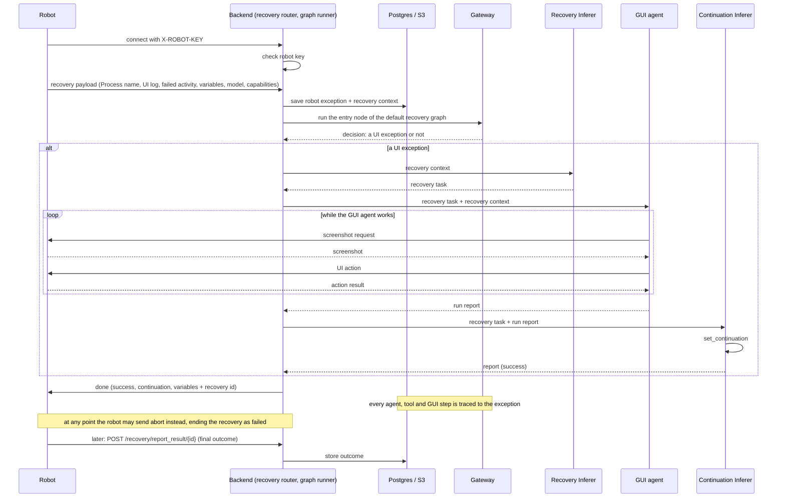

# Architecture

How the Reparo backend is put together today. This document explains concepts and how they
connect, and points to the code for detail. It does not list endpoints, fields or tables: the code
and the OpenAPI reference (`/scalar`) are the source of truth for those. What is implemented versus
planned is tracked in [`REQUIREMENTS.md`](REQUIREMENTS.md).

## 1. Overview

The backend is a single FastAPI application (`main.py`) that receives failures from RPA robots and
tries to recover them with LLM agents. Its main parts:

| Part | Role | Where |
| --- | --- | --- |
| Recovery ingress | WebSocket a robot opens when it fails; one recovery per connection | `routers/recovery.py` |
| Agents | Database-configured Strands agents (generic and GUI agents) that run as graph nodes, standalone or as tools of other agents | `database/agents/` |
| Agent graphs | Database-defined graphs of agent nodes, and the runner that executes a recovery one node at a time, starting at the gateway; seeded with the "UI Recovery" graph | `database/agent_graphs/`, `database/populators/agent_graphs.json` |
| Tools | Python functions agents can call, registered in the database | `database/tools/`, `agent_tools/`, `gateway/` |
| Provider routers | Which LLM backend and model each agent uses | `database/provider/`, `routers/provider.py` |
| Trace logging | Per-recovery record of agent, tool and GUI steps, with screenshots in S3 | `database/logging/`, `agent_tools/hooks.py`, `s3/` |
| Auth | Robot keys for robots, JWT sessions for users | `security/`, `middlewares/auth.py`, `routers/keys.py`, `routers/auth.py` |
| Observability | OpenTelemetry traces and logs exported to SigNoz | `observability/`, [`OBSERVABILITY.md`](OBSERVABILITY.md) |
| Evals | Offline benchmarks of the agents, plus an eval WebSocket | `evals/`, `routers/evals.py` |

State lives in Postgres (configuration and traces) and in S3-compatible storage (screenshots). The
supporting services run from `docker/` (see [`docker/README.md`](docker/README.md)).

## 2. Recovery lifecycle

1. **Connect.** A robot opens the recovery WebSocket with its robot key in the `X-ROBOT-KEY`
   header. Unknown or disabled keys are rejected before the socket is accepted. The server sends
   periodic pings while the recovery runs.
2. **Submit.** The robot sends one recovery payload. Its Contract version is checked first; then it
   is validated against the payload model (`templates/recovery_payload.py`) and normalised into a
   recovery context: the Process name, platform, the ordered UI log, the failed activity, the
   variables, the process model and the robot's capabilities (see [Robot protocol](#robot-protocol)).
3. **Persist.** The raw payload is saved as a robot exception together with its recovery context
   (`database/logging/models.py`). The exception id is the recovery id used everywhere afterwards.
4. **Run the agent graph.** Every recovery runs the enabled default recovery agent graph
   (`database/agent_graphs/models.py`). It is looked up before the exception is persisted, and
   loaded with every node's agent right before the run; the populator seeds "UI Recovery" as the
   default (see [Seeding](#3-agents)). The graph awaits one node at a time, from its entry node, inside the
   recovery, so an abort cancels it. After each node it follows the first outgoing edge, by
   priority, whose condition holds over the node's structured output, until none does or a graph
   limit is hit. Before each node it re-reads from the database whether every agent of the graph is
   still enabled; once one is disabled during the run, the next node is cancelled and the recovery
   ends with an internal error. The same check flags a graph as not runnable. Conditions are declarative predicates (`database/agent_graphs/conditions.py`),
   never evaluated as code; an edge without one always holds, and one that can't be evaluated
   doesn't. Each node's arguments bind from its
   input map, else by name from the recovery context and then from the earlier nodes' structured
   outputs. The WebSocket, the exception id and those outputs travel in the shared Strands
   invocation state, so every node and every nested agent and tool can reach the robot and attach
   its traces to the right recovery.
5. **Recover a UI exception.** In the seeded "UI Recovery" graph the gateway only classifies the
   failure. Anything but a UI exception goes to `route_to_human` and ends the graph at the gateway,
   which reports no `success`. A UI exception goes on to the Recovery Inferer, which writes the recovery task
   the GUI agent runs; then to the GUI agent, which acts on the desktop and reports what happened;
   then to the Continuation Inferer, which states whether the process was repaired and, if so,
   names the Event of the process model the robot should run next. It can only do so through the
   `set_continuation` tool (`agent_tools/utils.py`), which checks the Event against the model and the
   loop passes against the loops enclosing it (`agent_tools/process_model.py`). A wrong guess comes
   back to the agent as a correction, so it is fixed inside the agent loop instead of failing the
   recovery. Inside a node, agents can still call sub-agents as tools.
6. **Drive the desktop.** A GUI agent asks the robot for screenshots and sends it UI actions
   (click, type, scroll...) over the same WebSocket; the robot executes them and replies. This is the
   robot-side contract implemented by the test client in `scripts/recovery_ws_client/`.
7. **Finish.** The robot gets a `done` message with the recovery id. Only `success` comes from an
   agent: it is the last executed node's `success` field, false when missing or when the graph hit a
   limit; the continuation is the one `set_continuation` stored, and the variables are the
   payload's, as changed by the GUI agents. A reported success without a stored continuation, or
   after `set_continuation` declared the recovery failed, is sent as a failure. The success sent is stored on the exception. `done` is sent only for a recovery that
   was persisted and run; every other ending (an invalid payload, a server without a default recovery graph,
   an unexpected failure) is an `error` message with a machine-readable code, and the socket is
   closed. The robot can also end the recovery itself with `abort`.
8. **Report.** Once the robot (or its orchestrator) knows whether the process really continued, it
   reports the outcome through the report-result endpoint, authenticated with the same robot key.

### Robot protocol

The robot speaks first and once: the recovery payload. After that it only answers the server's
requests, except for `abort`, which it can send at any time. `robot/channel.py` owns the socket
from accept to close: it sends keep-alive pings, routes `abort` away from the frames the GUI tools
wait for, and closes the socket. The exact fields are in the models named below and in `/scalar`.

**The payload** (`RecoveryPayload`) describes the failed run. It opens with `contract_version`, the
Contract version the robot speaks. The field is required and checked before anything else in the
payload, on the recovery and the eval connection alike. Reparo speaks one Contract version at a
time, today 2, and accepts only that JSON integer: a missing or `null` version, another number, or
anything that isn't an integer (`"2"`, `2.0`, `true`) is refused, and so is a payload that is JSON
but not an object. The refusal's content names the version Reparo speaks and the one received. The
version is not stored with the recovery context.

Three kinds of id appear in the payload, and they mean different things:

- `model` is the **process model**, in BPMN 2.0 XML or another textual format (such as the
  Playwright bridge's compact outline). Its Event ids are **model event ids**: stable across runs and
  loop passes.
- Each UI log entry and the failed activity have an `event_id`, which only identifies that
  **occurrence** in this run (an Event performed three times in a loop has three), and an optional
  `model_event_id` naming the Event it performed. When `model_event_id` is missing, agents fall back
  to matching `event_name` against Event names.
- `activity_id` groups events semantically and is never a continuation target.

`capabilities` says how the robot can be observed and driven: the modalities it supports (`vision`,
`dom`, `a11y`), most preferred first, whether it supports Text targeting (`ocr`), and per-modality
details. A robot that sends none supports `vision` only. It is stored with the recovery context. For
now GUI agents use `vision` only, and refuse to act for a robot that leaves it out.

`ocr` (Text targeting) says the robot can find an element by the text it shows, so actions may be
aimed by visible text instead of coordinates. It is an option of the vision modality: it is
meaningful only when `vision` is declared, and is accepted and ignored otherwise. It never changes
what a screenshot contains.

`recovery_task` is the process author's own recovery task for the failed activity. Its promise
depends on the connection:

- On a **recovery** connection it is optional and experimental, and Reparo may ignore it. Today the
  recovery endpoint accepts it and ignores it, so the agents behave as if it were absent.
- On an **eval** connection it is required and run as given: it is the recovery task the GUI agent
  runs. A payload without one is refused with `error`, `VALIDATION_ERROR`, and close code 1003.

**During the recovery** the server sends `ping`, `screenshot` (the robot answers with one binary JPEG
frame) and `action` (the robot answers with a JSON result: `success`, `action_type` and, on failure,
`error`, which the GUI agent sees as a tool error).

**The recovery ends** in exactly one of these ways:

| Ending | Sent by | Message | Socket close |
| --- | --- | --- | --- |
| The recovery ran | server | `done`: the recovery `id` and `ResponseToRPA` (`templates/gateway.py`) | 1000 |
| The Contract version is missing or unsupported | server | `error`, `UNSUPPORTED_CONTRACT_VERSION` | 1003 |
| The payload is not JSON or not valid | server | `error`, `INVALID_RECOVERY_PAYLOAD` | 1003 |
| No enabled default recovery agent graph | server | `error`, `NO_AGENT_GRAPH` | 1011 |
| Anything unexpected | server | `error`, `INTERNAL_ERROR` | 1011 |
| The robot gives up | robot | `abort`, with its own `error_code` and `error_description` | 1000, no `done` |

`done.content` tells the robot whether the recovery worked and where to resume: `success`;
`process_finished` when the agents completed the rest of the process themselves;
`continue_from_model_event_id`, the Event to run next (naming the failed Event means "retry it", an
earlier one means "go back"); `loop_iteration`, one 0-based pass per loop enclosing that Event,
outermost first; and `variables`, the payload's variables as the recovery left them. Without
success there is no continuation. An `abort` cancels the agents and stores the robot's reason on
the exception, which counts as a failed recovery; an abort sent before the payload just closes the
socket.

## 3. Agents

**Agents are data, not code.** An agent is a database row (`database/agents/models.py`) holding its
prompt, its arguments and output model, input type (text or image + text), provider router, tools
and sub-agents. Invoking an agent builds a Strands agent from that row on the fly, validates the
inputs, runs it, and asks for a structured response in its output model.

- **Arguments and output models.** Both are data too (`database/agents/specs.py`): a list of field
  definitions, each a name, a small type expression (such as `str | None`, `list[int]` or
  `Literal['a', 'b']`) and a description, with an optional default. Type expressions are parsed
  against a whitelist and never evaluated. The output model's name and description are what the
  LLM sees as the structured-output tool. Pydantic classes are built from the definitions: the
  arguments validate inputs strictly, and the output model is what the agent reports. The rules
  live in that one module, so the API and the row check a definition the same way. GUI agents
  always report `GuiRunReport`.

- **Types.** `AgentType` distinguishes generic agents from GUI agents, the only type that runs
  differently. An agent's role in a recovery (gateway, inferer…) comes from its place in the graph,
  not from its type.
- **Composition.** Sub-agents are exposed to their parent as tools, so delegation is just a tool
  call. Each tool or sub-agent link can carry a call limit, enforced by a hook
  (`agent_tools/hooks.py`). Disabled agents are left out.
- **GUI agents.** GUI agents work from screenshots and emit UI actions. Every GUI agent runs through
  the tool-based loop (`database/agents/tooled_gui_agent.py`), which gives a grounding model one
  tool per action and is exposed to its parent as `tooled_guiagent`. A standalone UI-TARS loop
  (`database/agents/uitars.py`), which parses actions from the model's text output, is kept for a
  future rework; its text-based prompt is seeded with a disabled agent. A hook caps how many
  screenshots stay in the conversation.
- **Prompts.** An agent's prompt is part of its row; the robot's payload and result models live in
  `templates/`. A prompt names only the tools the agent is given and leaves the response layout to
  the output model. Prompts used only by the evals live in `evals/`.
- **Seeding.** `populate.py` creates the tables and the S3 bucket, then loads the default agents, sub-agent links, tools, provider routers,
  the admin user and the agent graph from `database/populators/` (`agents.json`, `routers.json`,
  the default agent prompts in `default_prompts/`, and `agent_graphs.json`). Seeding only creates
  what is missing, so a changed default prompt reaches fresh databases only. After that, agents,
  graphs and routers can be changed at runtime through the API without a deploy.
- **The seeded graph.** "UI Recovery" chains the gateway, the Recovery Inferer, the Tooled GuiAgent
  and the Continuation Inferer, past the gateway only on a UI exception. On a fresh database it is
  enabled as the default recovery graph once it passes the same validation as the API. The legacy
  UI Exception Handler, which did all of this as one agent calling the GUI agent as a tool, is
  seeded disabled for reference.
- **Migrating an older database.** A database seeded before the graph keeps its gateway's old
  prompt and output model, since seeding never overwrites an agent. There the graph is created
  disabled, recoveries keep running the gateway alone, and the populator prints the administrator
  API calls that switch over: disable the gateway-only graph, give the gateway its classification
  prompt and output model, disable the UI Exception Handler, and enable "UI Recovery" as the
  default recovery graph. It prints them on every run until they are made.
- **Editing agent graphs.** Administrators edit graphs, their nodes and their edges through the
  API. A disabled graph is a draft and accepts any structure; enabling a graph, and every write to
  an enabled one, must leave it runnable. Making a graph the default recovery graph takes over from
  the previous default. Agents are guarded too: an agent can't be disabled while an enabled graph
  uses it, deleted while any graph does, or have its arguments, output model or type changed in
  a way that breaks an enabled graph. The rules live in one module,
  `database/agent_graphs/service.py`, which the agent endpoints call as well.

## 4. Tools

A tool is a Strands `@tool` function registered in the database by its import path
(`database/tools/models.py`); an agent gets the tools linked to it. Shared tools are in
`agent_tools/`, and gateway-specific ones in `gateway/`. Adding a tool means writing the function
and registering it (see `database/populators/tools.py`).

## 5. LLM providers

A provider router (`database/provider/models.py`) names an OpenAI-compatible backend (OpenAI,
OpenRouter, vLLM), a model, an API key, its capabilities (text, vision) and, for vision models, the
backbone used to map coordinates. Every agent points at one router; an agent that takes images needs
a vision-capable router. Routers are seeded per role (`text`, `grounding`, ...) from
`routers.json`, and agents name the role they use. Each role's model comes from the `PROVIDER_*`
settings, and its provider, endpoint and key come from `ROUTER_<ROLE>_*` or the `PROVIDER*` defaults.
Routers are managed through `routers/provider.py`. OpenRouter routers also price a conversation from
its token usage; other providers report the cost as unknown (-1).

## 6. Trace logging and artifacts

Recoveries are recorded in the database, separately from OpenTelemetry, so they can be reviewed and
exported per recovery:

- **Agent graph traces**, one per agent graph run, recording how it ended, and a flat, ordered
  **node trace** per node execution that links to the node's agent trace. A node trace copies the
  condition of the edge it was entered by, so it stays readable after the graph is edited or
  deleted. The recovery opens and closes the agent graph trace; the runner opens and closes each
  node trace (`database/logging/agent_graph_tracing.py`), and the node's agent links its agent trace
  to it as soon as it starts.
- **Agent traces** with their messages, cost and tool traces. Each node's agent trace is a root:
  sequence lives in the node traces, while agents called as tools inside a node still nest under
  their caller as sub-agent traces. **Tool traces** have inputs, outputs and status; **GUI traces**
  the action taken and the screenshot it was based on. Hooks in `agent_tools/hooks.py` write them as
  agents run.
- Screenshots are stored in S3 (`s3/`), and deleted with their trace (`database/logging/orm_events.py`).
- `routers/logging.py` serves traces, the recovery context, markdown reports of an agent trace and of
  a whole agent graph run (each node in order, followed by its agent trace), and a ZIP with the UI
  log as CSV plus its screenshots.

## 7. Authentication

There are two separate schemes:

- **Robots** authenticate with robot keys (`X-ROBOT-KEY`) on the recovery and eval endpoints. Only a
  hash of each key is stored (`security/utils.py`); the plain key is shown once, at creation
  (`routers/keys.py`).
- **Users** log in for a JWT backed by a stored session (`routers/auth.py`, `security/`), checked by
  the dependencies in `middlewares/auth.py`. Roles are administrator and developer. Every management API
  (agents, tools, providers, keys, logging) needs a logged-in user; creating, changing or deleting
  agents, provider routers, robot keys and users needs an administrator.

## 8. Observability

The app exports traces and logs over OTLP to a self-hosted SigNoz. FastAPI requests, Strands agent,
model and tool calls, and the recovery turn share one trace; logs are structured and redacted.
Postgres and SeaweedFS telemetry is collected by an agent in the Docker stack. Everything about it is
in [`OBSERVABILITY.md`](OBSERVABILITY.md).

## 9. Evaluation

`evals/` holds offline runners that benchmark parts of the pipeline against a dataset: whether the
gateway routes errors correctly (`run_filter_eval.py`), whether a sensible recovery task is generated
(`run_task_eval.py`), and end-to-end recovery against a running server (`run_recovery_eval.py`).
`routers/evals.py` exposes an eval WebSocket that runs a chosen GUI agent on the payload's
`recovery_task`, which it requires, and infers where the robot should continue, with the same
`set_continuation` tool and answer as production.

## 10. Roadmap / not yet implemented

The original design describes more than this repository contains. None of the following exists yet;
the detailed list is in [`REQUIREMENTS.md`](REQUIREMENTS.md).

- **Human escalation.** The gateway's hand-off tool (`gateway/agent.py`) is a placeholder.
- **Cockpit UI** for monitoring sessions, handling escalations and managing agents and tools. The
  backend has APIs for some of this, but no UI.
- **Business knowledge base** queried by agents, and learning from past recoveries.
- **Script analysis and repair** of the robot's own automation.
- **Recovery modules** beyond the UI error path (`modules/` is reserved for them).
- **Asynchronous job queue**, horizontal scaling, and the performance and availability targets.
- **Enterprise auth** (MFA, LDAP/SAML/OAuth) and finer-grained roles.
